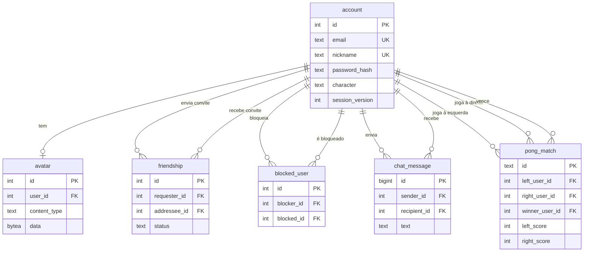

# ft_transcendence — Virtual Co-Work

Aplicação web full-stack da 42: um escritório virtual em 3D, em primeira pessoa, com chat, amigos, perfis e Pong multijogador em tempo real. O objetivo é reunir, em um único produto, autenticação, presença, conversas, partidas ao vivo e um ambiente 3D navegável com voz por proximidade.

- **Conceito e fluxo:** [`flow.md`](flow.md)
- **Créditos de assets:** [`CREDITS.md`](CREDITS.md)

## Equipe

| Integrante | GitHub | Papel principal | Áreas |
| --- | --- | --- | --- |
| Pedro Monteiro | [`peda-cos`](https://github.com/peda-cos) | Backend / banco / jogos | API Flask, autenticação, schema PostgreSQL, Pong, testes |
| Jonnathan Lacerda Santos | [`jonnathan-ls`](https://github.com/jonnathan-ls) | Frontend / produto | React, MUI, páginas de perfil, chat, amigos, termos e privacidade |
| Julio Henrique | [`JulioHOR`](https://github.com/JulioHOR) | 3D / tempo real | Colyseus, Babylon.js, voz WebRTC, modelos 3D |
| Fred Forte | `fforte-j` | 3D / infraestrutura | Cliente 3D, animações, Docker, testes e documentação do jogo |

A distribuição acima segue as áreas em que cada pessoa concentrou commits e o changelog do ambiente 3D (`3D-Environment/CHANGELOG.md`). O time tem 4 integrantes.

## Gestão

O trabalho foi organizado por **features em branches**, com **pull requests e merges**. O histórico tem 136 commits e 20 merges entre agosto e novembro de 2026. As mensagens seguem, na maior parte, o padrão `feat:`, `fix:`, `refactor:` e `test:`.

- Branches por feature (login, chat, Pong, 3D, Docker, documentação).
- Integração por PR/merge para `main`, commits pequenos por feature e testes automatizados no backend.
- Distribuição de tarefas por área, com o changelog do 3D registrando a autoria de cada bloco.

## Stack e justificativa

| Camada | Tecnologias | Por que |
| --- | --- | --- |
| Frontend | React 19, TypeScript, Vite, Material UI + Emotion, React Router, Socket.IO Client | Componentização, tipagem, componentes acessíveis e tema claro/escuro sem CSS artesanal. |
| Backend | Flask 3, Flask-Smorest, Flask-SocketIO, Gunicorn, psycopg2 | HTTP e WebSocket no mesmo processo, OpenAPI gerado a partir das rotas e SQL explícito para o schema relacional. |
| Banco | PostgreSQL 17 | Integridade referencial, `CHECK`, índices e transações para contas, amigos, chat e partidas. |
| 3D | Babylon.js, Colyseus, WebRTC | Renderização 3D no navegador, salas com estado sincronizado e voz ponto a ponto por proximidade. |
| Infra | Docker Compose, Nginx, OpenSSL, Docker secrets | Subida com um comando, HTTPS na borda e TLS interno entre Nginx e backend, sem segredos no Git. |

## Como executar

Pré-requisitos: Docker com Compose. O comando abaixo cria o `.env` a partir de `.env.example`, gera os secrets ausentes, cria o certificado interno e sobe os quatro serviços:

```sh
make up
```

Acesse **https://localhost:8443**. O certificado é autoassinado; aceite o aviso do navegador. Para usar outro host, ajuste `DOMAIN_NAME`, `LAN_IP` e `FRONT_PUBLIC_PORT` no `.env`.

```sh
make logs SERVICE=backend   # logs de um serviço
make down                   # para os containers
make re                     # limpa volumes/imagens e sobe de novo
```

O `.env` é local e ignorado pelo Git. Os secrets ficam em `secrets/` (também ignorado) e são montados em `/run/secrets/`:

| Arquivo | Uso |
| --- | --- |
| `secrets/db_password.txt` | senha do PostgreSQL |
| `secrets/flask_secret_key.txt` | assinatura da sessão Flask |
| `secrets/backend.crt` / `secrets/backend.key` | TLS interno entre Nginx e backend |

## Schema do banco

Os scripts de `database/init/` rodam na criação do volume. O schema é relacional e usa chaves estrangeiras, `CHECK`, `UNIQUE`, índices e triggers de `updated_at`.



Relações principais:

- `account` é a raiz; `avatar` tem no máximo uma imagem por conta.
- `friendship` guarda um convite direcionado (`pending`/`accepted`) e impede arestas duplicadas nos dois sentidos.
- `blocked_user` impede mensagens entre as contas; a PK composta lógica é `(blocker_id, blocked_id)`.
- `chat_message.recipient_id = NULL` identifica a sala pública; caso contrário, é uma conversa privada.
- `pong_match` referencia os dois jogadores e o vencedor, com `CHECK` de participação e placar não negativo.

## Funcionalidades implementadas

### Contas e sessão

- Cadastro, login, logout e sessão por cookie `HttpOnly`, `Secure` e `SameSite=Lax`.
- Senha com `scrypt` e salt aleatório (Werkzeug), mensagem genérica de credenciais e limite de tentativas.
- `session_version` invalida sessões antigas após logout.

### Perfil e amigos

- Edição de e-mail e apelido, upload/remoção de avatar e escolha de personagem do 3D.
- Perfil público, avatar público e presença online.
- Convite, aceite, rejeição e remoção de amigos; bloqueio/desbloqueio de mensagens.

### Chat

- Sala pública e conversas privadas persistidas no banco.
- Histórico, indicador de digitação, confirmação de leitura, bloqueio e convites de Pong pelo chat.
- Acesso ao perfil do autor a partir da mensagem.

### Pong

- Matchmaking 1v1, partida autoritativa no backend e placar em tempo real por WebSocket.
- Reconexão com pausa/retomada, revanche e saída de partida.
- Estatísticas: partidas, vitórias, derrotas, ranking, nível, conquistas, histórico e leaderboard.

### Ambiente 3D

- Escritório em primeira pessoa com Babylon.js e modelos GLB, colisões e animações.
- Colyseus sincroniza jogadores, nome, posição, orientação e arma equipada.
- Login do 3D reaproveita a sessão do dashboard via `GET /api/me`; sem sessão, a entrada é recusada em produção.
- Voz por proximidade via WebRTC, com fallback de texto no chat.
- Pontos de spawn e reconexão de assento.

### Infra e documentação

- Quatro containers: `database`, `backend`, `game` e `frontend`.
- HTTPS na borda e TLS interno; backend e banco não publicam portas no host.
- Swagger/OpenAPI em `/api/docs` e contrato WebSocket em `/api/docs/asyncapi.yaml`.
- Testes de backend com `pytest` e testes do servidor 3D com Mocha.

## Módulos da régua

A tabela abaixo declara **10 módulos** e **17 pontos** (7 majors × 2 + 3 minors × 1, conforme o subject). O mínimo é 14; os 3 pontos extras são pleiteados como bônus (máximo de 5). Cada linha tem implementação e evidência no código e nos testes.

| Categoria | Módulo | Tipo | Pontos | Dependências | Evidência | Responsável |
| --- | --- | --- | ---: | --- | --- | --- |
| Web | Framework no frontend e no backend | Major | 2 | — | React + Flask em `frontend/` e `backend/` | Pedro, Jonnathan |
| Web | Tempo real com WebSockets | Major | 2 | Framework | Socket.IO no chat, presença e Pong | Pedro, Jonnathan |
| Web | Usuários interagem entre si | Major | 2 | Framework, banco | Chat, perfil e amigos | Pedro, Jonnathan |
| User Management | Gestão padrão de usuários e autenticação | Major | 2 | Framework, banco | Cadastro/login, perfil, avatar, amigos online | Pedro, Jonnathan |
| Gaming | Jogo web completo | Major | 2 | Usuários, WebSockets | Pong 1v1 com regras e placar | Pedro, Jonnathan |
| Gaming | Jogadores remotos | Major | 2 | Jogo, WebSockets | Matchmaking, reconexão e partida entre navegadores | Pedro, Jonnathan |
| Gaming | Gráficos 3D avançados | Major | 2 | WebSockets, usuários | Ambiente Babylon/Colyseus com avatares e voz | Julio, Fred |
| User Management | Estatísticas e histórico de partidas | Minor | 1 | Jogo | `/api/games/pong/statistics` e perfil | Pedro, Jonnathan |
| Gaming | Chat avançado | Minor | 1 | Usuários interagem | Bloqueio, convites, digitação, leitura e histórico | Pedro, Jonnathan |
| Gaming | Gamificação | Minor | 1 | Jogo, estatísticas | Conquistas, níveis e leaderboard persistentes | Pedro, Jonnathan |

**Total: 17 pontos.** Bônus pleiteado: **3 pontos** (os três minors além do mínimo). Nenhum módulo é contado sem evidência funcional.

### Dependências entre módulos

- Chat avançado depende do módulo de interação entre usuários.
- Estatísticas e gamificação dependem do jogo.
- Jogadores remotos dependem do jogo e de WebSockets.
- O 3D depende da sessão de usuário e da camada de tempo real.

## Contribuições individuais

Contagens normalizadas por pessoa (o histórico bruto tem 136 commits e algumas identidades de e-mail duplicadas).

| Integrante | Commits aprox. | Principais entregas | Módulos |
| --- | ---: | --- | --- |
| Pedro Monteiro | ~45 | API Flask, auth/sessão, schema PostgreSQL, matchmaker/Pong, testes, Docker/HTTPS | 1–6, 8–10 |
| Jonnathan Lacerda Santos | ~41 | React/MUI, login/perfil, chat, amigos, termos/privacidade, integração do Pong | 1–6, 8–10 |
| Julio Henrique | ~26 | Colyseus, Babylon, voz WebRTC, modelos e cena 3D | 7 |
| Fred Forte | ~24 | Cliente 3D, animações, name tags, Docker do jogo, testes e documentação | 7 |

## API e contratos

- **Swagger UI:** `https://localhost:8443/api/docs`
- **OpenAPI JSON:** `https://localhost:8443/api/docs/openapi.json`
- **AsyncAPI (WebSocket):** `https://localhost:8443/api/docs/asyncapi.yaml`
- **Autenticação:** cookie de sessão para ações de usuário; `X-API-Key` para os endpoints públicos de leitura marcados na documentação.
- **Rate limit:** 120 req/min por IP; cadastro 3/hora e login 5/minuto.

Endpoints principais: `/api/auth/*`, `/api/me`, `/api/profile*`, `/api/friends*`, `/api/chat/*`, `/api/games/pong/statistics`.

## Testes

```sh
# Backend (171 testes; o alvo usa o .venv local)
python3 -m venv .venv
.venv/bin/pip install -r backend/app/requirements.txt -r backend/app/requirements-dev.txt
make test

# Servidor 3D (Mocha)
cd 3D-Environment && npm ci && npm test

# Frontend (build + lint)
cd frontend && npm ci && npm run build && npm run lint
```

O backend usa `pytest` com testes de auth, validação, schema, rate limit, matchmaker, handlers, store e API docs. O 3D usa `@colyseus/testing` para subir o servidor real e conectar clientes reais.

## Segurança e privacidade

- Senhas com `scrypt` e salt; cookies `HttpOnly`, `Secure` e `SameSite=Lax`.
- SQL sempre parametrizado; respostas de erro genéricas no login.
- Validação de tipos, formatos, tamanhos e MIME no frontend e no backend.
- Avatar com validação de imagem (Pillow), limite de tamanho e `Content-Security-Policy` restritiva.
- `.env` e `secrets/` fora do Git; `.env.example` sem valores.
- HTTPS de ponta a ponta: navegador → Nginx → backend; backend e banco sem portas públicas.
- Política de privacidade e termos acessíveis em `/privacy` e `/terms`.

## Limitações conhecidas

- A voz WebRTC não usa STUN/TURN; funciona na mesma máquina/rede local, não entre redes distintas.
- A posição no 3D é autoritativa no cliente (o servidor só valida números finitos); um cliente modificado poderia trapacear na posição.
- Pong é 1v1; não há torneio, espectador, IA nem personalização de jogo.
- Não há OAuth, 2FA, recuperação de senha, múltiplos idiomas nem exclusão de conta pelo app.
- O backend usa 1 worker Gunicorn e estado de matchmaking em memória; a escala horizontal não é suportada.
- O ambiente 3D é uma sala compartilhada; não há múltiplas salas nem whiteboard.

## Créditos

Assets de terceiros: [`CREDITS.md`](CREDITS.md). Modelos 3D e texturas seguem as licenças indicadas.
