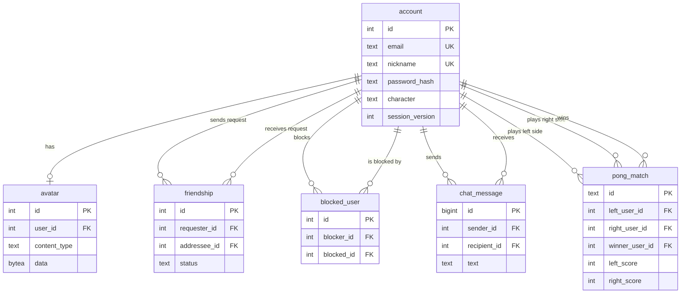

*This project has been created as part of the 42 curriculum by peda-cos, fforte-j, jlacerda, juhenriq.*

# ft_transcendence — Virtual Co-Work

A full-stack web application built for 42: a first-person 3D virtual office with chat, friends, profiles and real-time multiplayer Pong. The goal is to bring authentication, presence, messaging, live matches and a navigable 3D environment with proximity voice chat together in a single product.

- **Concept and flow:** [`flow.md`](flow.md)
- **Asset credits:** [`CREDITS.md`](CREDITS.md)

## Team

| Member | GitHub | Main role | Areas |
| --- | --- | --- | --- |
| Pedro Monteiro | [`peda-cos`](https://github.com/peda-cos) | Developer / Backend / database | Flask API, authentication, PostgreSQL schema, Pong, tests |
| Jonnathan Lacerda Santos | [`jlacerda`](https://github.com/jonnathan-ls) | Tech Lead / Frontend / product / Pong | React, MUI, profile pages, Pong, chat, friends, terms and privacy |
| Julio Henrique | [`juhenriq`](https://github.com/JulioHOR) | PM / 3D / real-time | Colyseus, Babylon.js, WebRTC voice, 3D models |
| Fred Forte | `fforte-j` | PO / 3D / infrastructure | 3D client, animations, Docker, game tests and documentation |

The breakdown above reflects the areas where each member concentrated their commits, as well as the 3D environment changelog (`3D-Environment/CHANGELOG.md`). The team has 4 members.

## Project management

Work was organized as **feature branches** integrated through **pull requests and merges**. The history contains 136 commits and 20 merges between August and November 2026. Commit messages mostly follow the `feat:`, `fix:`, `refactor:` and `test:` convention.

- One branch per feature (login, chat, Pong, 3D, Docker, documentation).
- Integration into `main` via PR/merge, small per-feature commits and automated backend tests.
- Tasks split by area, with the 3D changelog recording who authored each part.

## Stack and rationale

| Layer | Technologies | Why |
| --- | --- | --- |
| Frontend | React 19, TypeScript, Vite, Material UI + Emotion, React Router, Socket.IO Client | Component-based UI, static typing, accessible components and light/dark themes without hand-written CSS. |
| Backend | Flask 3, Flask-Smorest, Flask-SocketIO, Gunicorn, psycopg2 | HTTP and WebSocket in the same process, OpenAPI generated from the routes, and explicit SQL for the relational schema. |
| Database | PostgreSQL 17 | Referential integrity, `CHECK` constraints, indexes and transactions for accounts, friends, chat and matches. |
| 3D | Babylon.js, Colyseus, WebRTC | In-browser 3D rendering, rooms with synchronized state and peer-to-peer proximity voice. |
| Infra | Docker Compose, Nginx, OpenSSL, Docker secrets | Single-command startup, HTTPS at the edge and internal TLS between Nginx and the backend, with no secrets in Git. |

## Getting started

Prerequisites: Docker with Compose. The command below creates `.env` from `.env.example`, generates any missing secrets, creates the internal certificate and starts all four services:

```sh
make up
```

Open **https://localhost:8443**. The certificate is self-signed, so accept the browser warning. To use a different host, set `DOMAIN_NAME`, `LAN_IP` and `FRONT_PUBLIC_PORT` in `.env`.

```sh
make logs SERVICE=backend   # logs for a single service
make down                   # stop the containers
make re                     # wipe volumes/images and start again
```

`.env` is local and ignored by Git. Secrets live in `secrets/` (also ignored) and are mounted at `/run/secrets/`:

| File | Purpose |
| --- | --- |
| `secrets/db_password.txt` | PostgreSQL password |
| `secrets/flask_secret_key.txt` | Flask session signing key |
| `secrets/backend.crt` / `secrets/backend.key` | Internal TLS between Nginx and the backend |

## Database schema

The scripts in `database/init/` run when the volume is first created. The schema is relational and uses foreign keys, `CHECK` and `UNIQUE` constraints, indexes and `updated_at` triggers.



Key relationships:

- `account` is the root table; `avatar` holds at most one image per account.
- `friendship` stores a directed request (`pending`/`accepted`) and prevents duplicate edges in either direction.
- `blocked_user` prevents messaging between two accounts; its logical composite key is `(blocker_id, blocked_id)`.
- `chat_message.recipient_id = NULL` marks the public room; any other value is a private conversation.
- `pong_match` references both players and the winner, with `CHECK` constraints on participation and non-negative scores.

## Implemented features

### Accounts and sessions

- Sign-up, login, logout and cookie-based sessions (`HttpOnly`, `Secure`, `SameSite=Lax`).
- Passwords hashed with `scrypt` and a random salt (Werkzeug), a generic invalid-credentials message and login rate limiting.
- `session_version` invalidates old sessions on logout.

### Profiles and friends

- Edit email and nickname, upload/remove an avatar and choose a 3D character.
- Public profile, public avatar and online presence.
- Send, accept, decline and remove friend requests; block/unblock messages.

### Chat

- Public room and private conversations persisted to the database (WebSocket).
- Message history, typing indicator, read receipts, blocking and Pong invites from the chat.
- Open the author's profile directly from a message.

### Pong

- 1v1 matchmaking, server-authoritative matches and real-time scoring over WebSocket.
- Reconnection with pause/resume, rematch and leaving a match.
- Statistics: matches played, wins, losses, ranking, level, achievements, match history and leaderboard.

### 3D environment

- First-person office built with Babylon.js and GLB models, with collisions and animations.
- Colyseus synchronizes players' names, positions, orientations and equipped weapons.
- The 3D login reuses the dashboard session via `GET /api/me`; without a session, entry is refused in production.
- Proximity voice chat over WebRTC, with a text chat fallback.
- Spawn points and seat reconnection.

### Infrastructure and documentation

- Four containers: `database`, `backend`, `game` and `frontend`.
- HTTPS at the edge and internal TLS; the backend and database expose no ports on the host.
- Swagger/OpenAPI at `/api/docs` and the WebSocket contract at `/api/docs/asyncapi.yaml`.
- Backend tests with `pytest` and 3D server tests with Mocha.

## Modules

The table below declares **10 modules** for **17 points** (7 majors × 2 + 3 minors × 1, as defined in the subject). The minimum is 14; the 3 extra points are claimed as a bonus (5 at most). Every row is backed by implementation and evidence in the code and tests.

| Category | Module | Type | Points | Dependencies | Evidence | Owner |
| --- | --- | --- | ---: | --- | --- | --- |
| Web | Frontend and backend frameworks | Major | 2 | — | React + Flask in `frontend/` and `backend/` | Pedro, Jonnathan |
| Web | Real-time features with WebSockets | Major | 2 | Framework | Socket.IO for chat, presence and Pong | Pedro, Jonnathan |
| Web | User interaction | Major | 2 | Framework, database | Chat, profiles and friends | Pedro, Jonnathan |
| User Management | Standard user management and authentication | Major | 2 | Framework, database | Sign-up/login, profile, avatar, online friends | Pedro, Jonnathan |
| Gaming | Complete web-based game | Major | 2 | Users, WebSockets | 1v1 Pong with rules and scoring | Pedro, Jonnathan |
| Gaming | Remote players | Major | 2 | Game, WebSockets | Matchmaking, reconnection and cross-browser matches | Pedro, Jonnathan |
| Gaming | Advanced 3D graphics | Major | 2 | WebSockets, users | Babylon/Colyseus environment with avatars and voice | Julio, Fred |
| User Management | Game statistics and match history | Minor | 1 | Game | `/api/games/pong/statistics` and profile page | Pedro, Jonnathan |
| Gaming | Advanced chat | Minor | 1 | User interaction | Blocking, invites, typing indicator, read receipts and history | Pedro, Jonnathan |
| Gaming | Gamification | Minor | 1 | Game, statistics | Persistent achievements, levels and leaderboard | Pedro, Jonnathan |

**Total: 17 points.** Bonus claimed: **3 points** (the three minors beyond the minimum). No module is counted without working evidence.

### Module dependencies

- Advanced chat depends on the user interaction module.
- Statistics and gamification depend on the game.
- Remote players depend on the game and on WebSockets.
- The 3D environment depends on user sessions and the real-time layer.

## Individual contributions

Counts are normalized per person (the raw history has 136 commits and some duplicate email identities).

| Member | Approx. commits | Main deliverables | Modules |
| --- | ---: | --- | --- |
| Pedro Monteiro | ~45 | Flask API, auth/sessions, PostgreSQL schema, matchmaker/Pong, tests, Docker/HTTPS | 1–6, 8–10 |
| Jonnathan Lacerda Santos | ~41 | React/MUI, login/profile, chat, friends, terms/privacy, Pong integration | 1–6, 8–10 |
| Julio Henrique | ~26 | Colyseus, Babylon, WebRTC voice, 3D models and scene | 7 |
| Fred Forte | ~24 | 3D client, animations, name tags, game Docker setup, tests and documentation | 7 |

## API and contracts

- **Swagger UI:** `https://localhost:8443/api/docs`
- **OpenAPI JSON:** `https://localhost:8443/api/docs/openapi.json`
- **AsyncAPI (WebSocket):** `https://localhost:8443/api/docs/asyncapi.yaml`
- **Authentication:** session cookie for user actions; `X-API-Key` for the public read-only endpoints flagged in the documentation.
- **Rate limits:** 120 req/min per IP; sign-up 3/hour and login 5/minute.

Main endpoints: `/api/auth/*`, `/api/me`, `/api/profile*`, `/api/friends*`, `/api/chat/*`, `/api/games/pong/statistics`.

## Testing

```sh
# Backend (171 tests; the target uses the local .venv)
python3 -m venv .venv
.venv/bin/pip install -r backend/app/requirements.txt -r backend/app/requirements-dev.txt
make test

# 3D server (Mocha)
cd 3D-Environment && npm ci && npm test

# Frontend (build + lint)
cd frontend && npm ci && npm run build && npm run lint
```

The backend uses `pytest`, covering auth, validation, schema, rate limiting, the matchmaker, handlers, the store and the API docs. The 3D server uses `@colyseus/testing` to spin up the real server and connect real clients.

## Security and privacy

- Passwords hashed with `scrypt` and a salt; `HttpOnly`, `Secure` and `SameSite=Lax` cookies.
- Always-parameterized SQL; generic error responses on login.
- Type, format, size and MIME validation on both frontend and backend.
- Avatar image validation (Pillow), size limits and a strict `Content-Security-Policy`.
- `.env` and `secrets/` kept out of Git; `.env.example` contains no values.
- End-to-end HTTPS: browser → Nginx → backend; the backend and database have no public ports.
- Privacy policy and terms of service available at `/privacy` and `/terms`.

## Known limitations

- WebRTC voice does not use STUN/TURN; it works on the same machine or local network, but not across different networks.
- 3D positions are client-authoritative (the server only checks that values are finite), so a modified client could cheat on position.
- Pong is 1v1 only; there are no tournaments, spectators, AI opponents or game customization.
- No OAuth, 2FA, password recovery, multiple languages or in-app account deletion.
- The backend runs a single Gunicorn worker with in-memory matchmaking state, so horizontal scaling is not supported.
- The 3D environment is a single shared room; there are no multiple rooms and no whiteboard.

## Credits

Third-party assets: [`CREDITS.md`](CREDITS.md). 3D models and textures follow the licenses listed there.